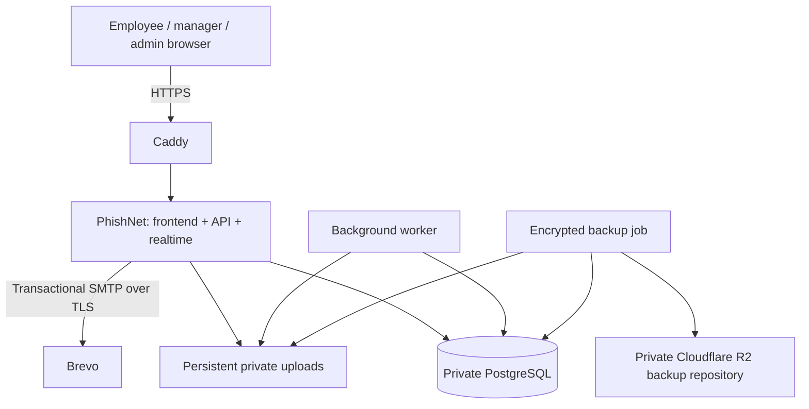

<proposed_plan>
# PhishNet near-free production deployment plan

## 1. Recommended hosting and budget

**Deploy a small production pilot on one Oracle Cloud Always Free VM**, supporting up to three organizations and 100 employees initially. This is a capacity target to validate, not an established benchmark.

Keep the frontend, backend, database and background worker together. This matches PhishNet’s existing architecture and avoids paying for separate hosting services.

Prices and limits checked on **13 November 2026**.

| Component | Selected service | Expected cost |
|---|---|---:|
| Server | Oracle Ampere A1: 2 OCPUs, 12 GB RAM | $0 within allowance |
| Database | PostgreSQL 17 on the same VM | Included |
| Frontend, backend and APIs | PhishNet production containers | Included |
| Persistent disk | 80 GB boot volume | $0 within allowance |
| DNS | Cloudflare Free DNS | $0 |
| HTTPS certificates | Caddy automatic HTTPS | $0 |
| Off-host backups | Cloudflare R2 Standard | $0 within free allowance |
| Account invitations and password resets | Brevo Free transactional SMTP | $0 within allowance |
| Domain registration | One ordinary `.com`, purchased separately | Budget $10–20/year; confirm registration and renewal prices |

Oracle currently lists **2 OCPUs/12 GB RAM equivalent** and **200 GB combined boot/block storage** for Always Free tenancies. Availability is not guaranteed, and idle instances may be reclaimed. These constraints make this suitable for a cost-conscious pilot rather than a high-availability service. [Oracle limits and conditions](https://docs.oracle.com/en-us/iaas/Content/FreeTier/freetier_topic-Always_Free_Resources.htm)

R2 includes 10 GB-month of Standard storage and operation allowances; excess usage is billable. Brevo currently includes 300 email sends daily. [R2 pricing](https://developers.cloudflare.com/r2/pricing/), [Brevo limits](https://help.brevo.com/hc/en-us/articles/208589409-About-Brevo-s-pricing-plans)

**Fallback:** AWS Lightsail with 4 GB RAM, 80 GB disk and public IPv4, currently **$24/month**, excluding backups and other extras. Do not provision this automatically if Oracle capacity is unavailable. [AWS bundle specifications](https://docs.aws.amazon.com/lightsail/latest/userguide/amazon-lightsail-bundles.html)

Google Cloud’s free VM allowance is an `e2-micro` in selected US regions, with limited disk/egress allowances; external IPv4 has separate charges. I would not select it for this combined application, database and continuous-worker workload. [Google free tier](https://docs.cloud.google.com/free/docs/free-cloud-features), [IPv4 pricing](https://cloud.google.com/vpc/network-pricing)

## 2. Architecture and connections



Use one public application address: `https://app.<your-domain>`.

- Express serves the compiled frontend and `/api` routes from the same origin.
- Caddy terminates HTTPS and forwards normal requests and realtime connections to the application.
- PostgreSQL sessions, campaign queues and application records remain private.
- App and worker share the existing uploads volume.
- Only Caddy publishes ports 80/443. PostgreSQL and application port 5000 have no public port mappings.
- SSH uses keys and is restricted to the operator’s current IP.
- Cloudflare initially provides **DNS only**, avoiding another proxy layer while validating cookies, client addresses and tracking.
- No separate frontend host, API Gateway, Redis, load balancer or Kubernetes cluster.

Production configuration must include:

| Setting | Required value |
|---|---|
| `NODE_ENV` | `production` |
| `APP_BASE_URL`, `CORS_ORIGINS` | Exactly `https://app.<your-domain>` |
| `DATABASE_URL` | Restricted `phishnet_web` connection |
| `CONTROL_DATABASE_URL` | Separate `phishnet_control` connection |
| Migration credentials | Available only to one-off maintenance tasks |
| `SESSION_SECRET` | Newly generated production secret |
| `MASTER_ENCRYPTION_KEY` | Newly generated 32-byte key, base64 encoded |
| `LOCAL_MAILBOX_ENABLED` | `false` |
| `SIMULATION_EXTERNAL_DELIVERY_ENABLED` | `false` initially |
| `WORKER_DELIVERY_PAUSED` | `true` during installation and acceptance |
| Optional paid AI/threat-feed integrations | Disabled unless explicitly configured and tested |

Keep runtime database accounts non-owner and non-superuser. Preserve the existing RLS design; do not weaken it to fit a free managed database.

## 3. Deployment sequence

### A. Prepare the release

Use the existing Compose deployment as the starting point, but complete these prerequisites:

- Build and test on Linux ARM64 using a clean `npm ci`; never upload copied Windows `node_modules`.
- Pin application releases by image digest and pin infrastructure image versions.
- Exclude private demo credentials, audit configuration, database exports and backups from Docker build contexts and release artifacts.
- Add a one-time production-admin bootstrap command. It must create the initial organization/admin, accept the password without logging it, refuse to overwrite an existing admin, and require MFA setup.
- Add production backup, restore and monitoring procedures.
- Correct the CI order: start the isolated backend before API-dependent foundation tests. Prepare required test fixtures before their suites.
- Run fresh-database bootstrap through all current runtime migrations, then provision the separate database roles.

No production API redesign is required. Deployment changes affect configuration, packaging and operational tooling.

### B. Create the infrastructure

- Create one Oracle account with MFA; choose **Dubai as the default home region**.
- Provision an Always Free-labelled A1 VM with 2 OCPUs, 12 GB RAM, Ubuntu 24.04 ARM64 and an 80 GB boot volume.
- If free capacity is unavailable, retry for up to 48 hours. Do not create additional accounts or silently choose billable resources.
- Install Docker Engine and Compose using official packages.
- Create separate application, database and certificate volumes.
- Configure restart policies and bounded container-log retention.
- Create a private R2 backup bucket and narrowly scoped backup credentials.
- Purchase the domain, configure Cloudflare DNS, and point `app` to the VM’s public IPv4 address. Do not create an AAAA record until IPv6 is configured and tested.

### C. Start PhishNet

Use a **fresh production database**. Do not import the audit database or demo accounts.

The runbook will provide this deployment order:

```text
1. Start PostgreSQL and wait for its health check.
2. Run schema bootstrap and runtime migrations.
3. Provision restricted runtime database accounts.
4. Bootstrap the production administrator.
5. Start the application, paused worker and Caddy.
6. Verify HTTPS, authentication, persistence and role boundaries.
7. Configure and test transactional email.
8. Complete off-host restore and load checks.
9. Invite the first pilot organization.
```

Use the existing starter-content installer only after reviewing its content. Keep the local demo environment separate and unchanged.

### D. Connect email

- Configure Brevo for genuine invitations, account verification and password resets.
- Set `TRANSACTIONAL_SMTP_HOST`, port 587, username, password and `TRANSACTIONAL_FROM_EMAIL`.
- Publish provider-issued domain authentication records and verify SPF/DKIM/DMARC behavior.
- Test invitation acceptance, password reset, expired links and provider rejection.
- Keep simulated campaign email disabled. Its eventual provider must explicitly support the intended simulation use; a general-purpose email free tier is not assumed suitable.
- Do not default simulations to Amazon SES: AWS explicitly identifies simulated-phishing content among sending-review concerns. [SES sending-review documentation](https://docs.aws.amazon.com/ses/latest/dg/faqs-enforcement.html)

Before enabling ordinary background maintenance while simulations remain disabled, verify that scheduled simulations stay blocked without creating repeated failures or retry loops.

## 4. Recovery, monitoring and launch acceptance

**Backups**

- Nightly database and uploads backups using encrypted restic storage in R2.
- Use a short announced maintenance window to stage a consistent database dump and uploads copy; resume service before uploading the staged backup.
- Include production configuration and encryption material inside the encrypted backup.
- Keep the independent recovery password in an operator password vault and an offline recovery copy.
- Retain seven daily recovery points initially; alert at 8 GB backup storage and review retention before approaching the free allowance.
- Target **RPO: 24 hours; RTO: four hours**. These remain targets until demonstrated.
- Restore onto a separate database and uploads directory before customer launch, then repeat monthly. Verify record counts, files, login and decryption of representative secrets.

The current local backup scripts are useful foundations, but their audit restrictions and local-file assumptions must not be presented as a completed production recovery system. [Restic repository and encryption documentation](https://restic.readthedocs.io/en/stable/030_preparing_a_new_repo.html)

**Monitoring**

Monitor public readiness, worker heartbeat, database connectivity, disk use, container restarts, certificate expiry and backup age. Alert when:

- Readiness fails repeatedly for five minutes.
- Worker heartbeat is absent for two minutes.
- Disk usage exceeds 75%.
- No successful backup exists within 26 hours.
- A delivery becomes ambiguous.
- Storage or email usage approaches its free allowance.

Send alerts to an operator address outside PhishNet’s own mail configuration. Provider budget alerts are notifications, not universal hard spending caps.

**Acceptance tests**

- Fresh installation and VM/container restart preserve records, uploads and sessions.
- HTTPS redirects, secure cookies, login/logout, invitations and reset links work.
- Admin, organization-admin, manager and employee permissions pass; cross-tenant requests are denied.
- Notifications, content, learning paths, reports, exports and realtime updates work at the public domain.
- Database port, application port and metrics are inaccessible without their intended protection.
- A 30-minute test with 25 concurrent users achieves a target API p95 below one second, below 1% server errors, and no memory exhaustion. Exclude external SMTP/video latency from this API measurement.
- Off-host recovery succeeds and produces recorded recovery timings.
- No simulation is launched by deployment or acceptance testing.

For upgrades, take a verified backup, apply additive migrations once, deploy the pinned release and repeat smoke tests. Roll back the image only when schema-compatible; otherwise use the documented recovery procedure.

## 5. Deliverable and operating limits

Save the completed runbook as:

`docs/production-deployment-plan-2026-11-13.md`

It must contain the architecture, cost worksheet, source links, configuration checklist, exact deployment commands, account prerequisites, recovery procedure, acceptance results template and AWS fallback.

**Defaults:** near-zero infrastructure cost, Oracle first, fresh production data, one server, three organizations/100 employees initially, no simulation sending, and no paid optional APIs. Domain purchase, account eligibility, operator email and production secrets are deployment inputs.

This design has a single-server failure domain and possible free-instance reclamation. Move to paid hosting when customers require stronger availability or measured load exceeds the pilot’s limits.

**File status:** the contents are planned here; no file has been written because Plan mode prohibits filesystem changes. Executing this request after leaving Plan mode means saving the runbook, not purchasing services or deploying cloud resources.
</proposed_plan>
